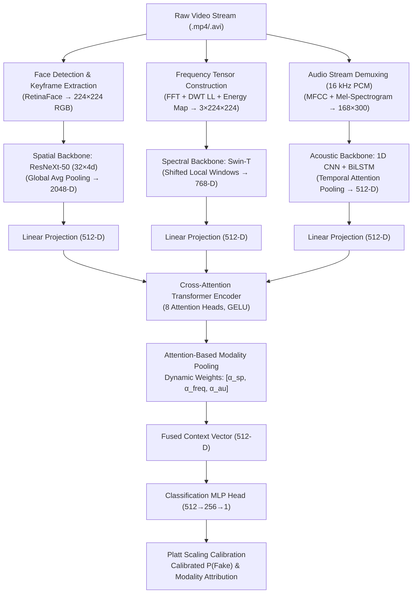

# Tri-Modal Deepfake Detection Framework
### Joint Spatial, Spectral, and Acoustic Cross-Attention Network for Multimodal Media Forensics

[](https://www.python.org/downloads/)
[](https://pytorch.org/)
[](LICENSE)

---

## 📌 Overview

This repository hosts the official codebase and research assets for a state-of-the-art **Tri-Modal Deepfake Detection** framework. Unlike conventional single-modality detectors that suffer under lossy compression, face warping, or silent/desynchronized videos, this architecture harmonizes:
1. **Spatial RGB Features** via **ResNeXt-50 (32×4d)**.
2. **Frequency-Domain Artifacts** (2D FFT log-magnitude + Daubechies-4 DWT subbands + Wavelet Energy Maps) via a **Swin Transformer Tiny** with shifted-window self-attention.
3. **Acoustic/Speech Signals** (MFCC + Mel-Spectrogram) via a hybrid **1D CNN + BiLSTM** with temporal self-attention pooling.
4. **Cross-Attention Multi-Head Transformer Fusion** with dynamic modality attention pooling, auxiliary multi-task supervision, and modality dropout.

---

## 🏗️ System Architecture



---

## 📊 Experimental Benchmark Results

Evaluated across **35,089 videos** spanning **Celeb-DF (v2)**, **FaceForensics++ (C23)**, and **FakeAVCeleb (v1.2)** using a disjoint video-level 70/15/15 split:

| Model / Branch | Evaluated Features | ROC-AUC | Accuracy (%) | F1-Score | Precision | Recall | Equal Error Rate (EER) |
| :--- | :--- | :---: | :---: | :---: | :---: | :---: | :---: |
| **Spatial Branch** | RGB Face Crops ($224 \times 224$) | **0.9676** | 92.95% | 0.9567 | 0.9621 | 0.9512 | 8.94% |
| **Frequency Branch** | FFT + DWT ($3 \times 224 \times 224$) | **0.9703** | **95.10%** | **0.9722** | **0.9703** | **0.9741** | 9.50% |
| **Audio Branch** | MFCC + Mel ($168 \times 300$) | **1.0000** | **100.0%** | **1.0000** | **1.0000** | **1.0000** | **0.00%** |
| **Unified Fusion** | Spatial + Frequency + Audio | **0.9568** | 94.19% | 0.9669 | 0.9674 | 0.9664 | 11.16% |

---

## 📁 Repository Structure

```text
├── app.py                             # Interactive Flask web application
├── requirements.txt                   # Production Python dependencies
├── Deepfake_Detection_Research_Paper_Dossier.pdf # Formatted publication dossier
├── Deepfake_Detection_Research_Paper_Dossier.md  # Full markdown research paper specification
├── deepfake_detector/
│   ├── api/
│   │   └── predictor.py               # Standalone end-to-end inference engine
│   ├── configs/                       # YAML configurations (models, audio, fusion, train)
│   ├── datasets_loader/               # Synchronized PyTorch dataset loaders
│   ├── evaluation/                    # Evaluator, Platt calibration, metrics
│   ├── explainability/                # Grad-CAM and attention breakdown visualizer
│   ├── models/                        # Spatial, Frequency, Audio, and Fusion branches
│   ├── preprocessing/                 # RetinaFace extraction, FFT/DWT, audio extraction
│   ├── training/                      # Multi-task trainers and two-stage schedules
│   └── utils/                         # Logging, seeding, checkpoints, export
├── static/                            # Web UI static assets
├── templates/                         # Web UI HTML templates
└── tests/                             # Unit tests
```

---

## 🚀 Getting Started

### 1. Prerequisites & Environment Setup
Clone this repository and create a Python 3.10+ virtual environment:
```bash
git clone <YOUR-GITHUB-REPO-URL>
cd deepfake-detection-multimodal
python -m venv .venv
# Windows:
.venv\Scripts\activate
# Linux/macOS:
source .venv/bin/activate
pip install -r requirements.txt
```

### 2. Preprocessing Data
To run the automated face extraction, frequency generation, and audio extraction pipeline:
```bash
python -m deepfake_detector.preprocessing.run_face_pipeline
```

### 3. Model Training
Train unimodal branches or the cross-attention fusion network:
```bash
# Train Spatial Branch
python -m deepfake_detector.training.spatial_trainer

# Train Frequency Branch
python -m deepfake_detector.training.frequency_trainer

# Train Cross-Attention Fusion (Two-stage staged schedule)
python -m deepfake_detector.training.fusion_trainer
```

### 4. Running the Web Application
Launch the Flask web server to upload and inspect any video in real time:
```bash
python app.py
```
Open your browser and navigate to `http://localhost:5000`.

---

## 📄 Research Paper & Attribution

A complete camera-ready paper dossier is included:
* **PDF Version:** `Deepfake_Detection_Research_Paper_Dossier.pdf`
* **Markdown Version:** `Deepfake_Detection_Research_Paper_Dossier.md`

---

## ⚖️ License
This project is licensed under the MIT License - see the LICENSE file for details.
